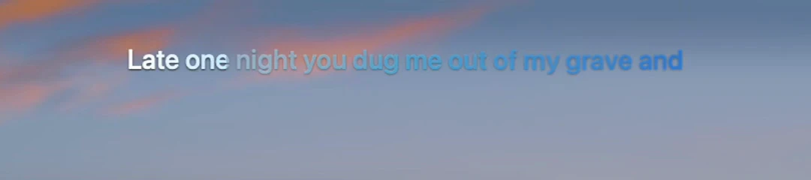
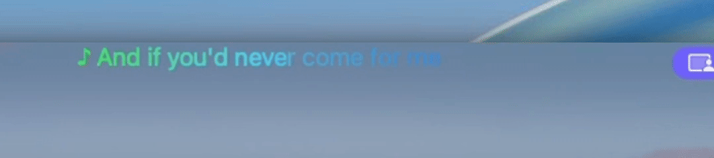
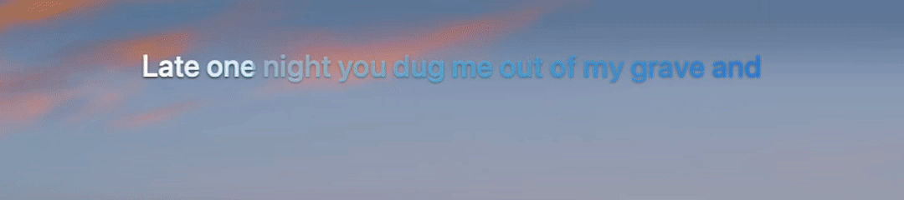
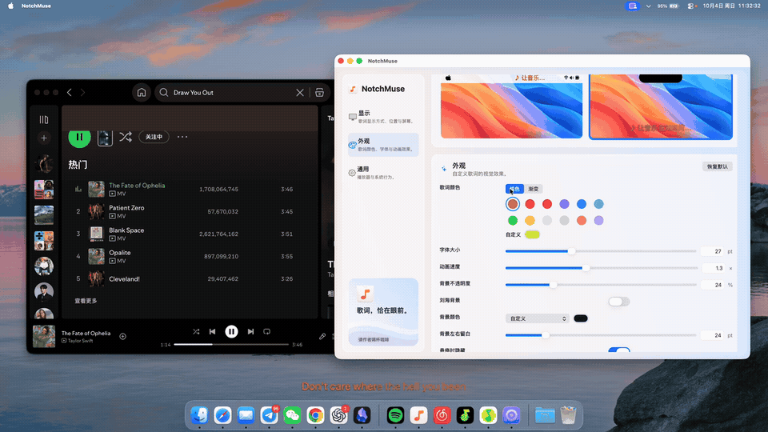
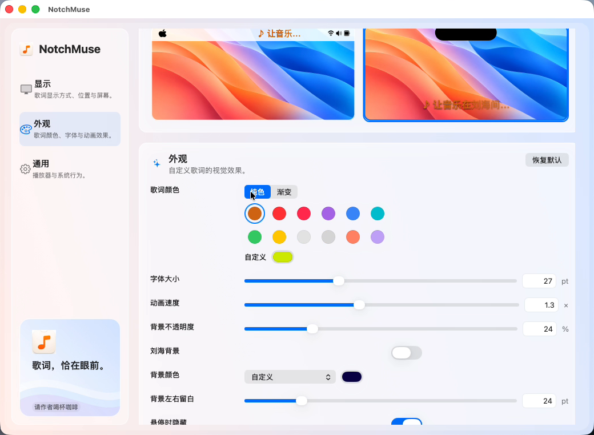
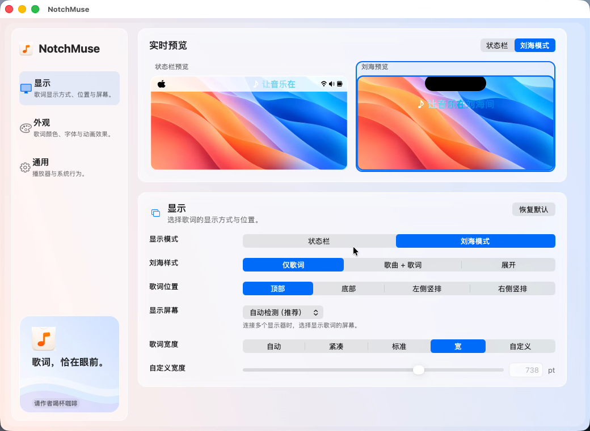
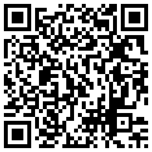
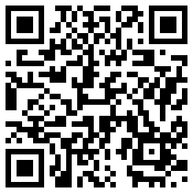

English | <a href="README.zh-CN.md">简体中文</a>

<h1 align="center">NotchMuse v0.8.1</h1>

Synced lyrics in your Mac menu bar, beside the notch, or at the edge of your screen.

macOS 14+ · Apple Silicon · Spotify · Apple Music · NetEase Cloud Music · QQ Music · Soda Music

<a href="https://notchmuse.com"><strong>Download from website</strong></a> · <a href="https://github.com/Xiye88/NotchMuse/releases/tag/v0.8.1"><strong>GitHub Releases</strong></a> · <a href="https://github.com/Xiye88/NotchMuse/issues"><strong>Report an issue</strong></a>

## Status Bar Lyrics

Synced lyrics live naturally inside your Mac menu bar, with adjustable placement.

## Notch Mode

Keep lyrics near the notch, or move the overlay above the Dock. This recording shows the top and Dock positions.

## Customize Your Lyrics

Choose solid colors, gradients, and a background to suit your desktop.

Display Settings

## Supported Players

Spotify · Apple Music · NetEase Cloud Music · QQ Music · Soda Music. Choose a player manually or let Auto Detect follow the one currently playing.

## Core Features

| Lyrics display | Personalization | Everyday use |
| --- | --- | --- |
| Status Bar and Notch lyrics | Solid and gradient colors | Auto Detect |
| Left or right side lyrics | Background, opacity, and width | English and Simplified Chinese |
| Lyrics above the Dock | Appearance presets | In-app update controls |
| Custom width and position | System, Light, and Dark appearance | Launch at Login; Dock and menu bar icon controls |

NetEase, QQ Music, and Soda Music use the bundled MediaRemote bridge. No Homebrew or separate helper installation is needed. Compatibility can change after a macOS or player update.

## Quick Start

1. [Download NotchMuse](https://notchmuse.com), open the DMG, and drag the app to Applications.
2. Open a supported desktop player and play a song. Allow macOS Automation access for Spotify or Apple Music if asked.
3. Open NotchMuse, keep Auto Detect selected, and choose your lyric position in Settings.

## Installation and Security

NotchMuse is distributed directly through the website and GitHub. Apple Developer ID signing and notarization are not configured yet, so macOS may show a first-launch security warning. This is a distribution-signing limitation, not a version status.

If macOS blocks the app, open **System Settings → Privacy & Security → Open Anyway** for NotchMuse, authenticate if asked, then open it again. See [Support](docs/community/SUPPORT.md) for installation and permission help. Do not disable Gatekeeper or remove quarantine to force installation. [Apple’s Open Anyway guidance](https://support.apple.com/en-us/102445). This release is ad-hoc signed, not Developer ID signed or notarized. Independent clean-Mac first-install verification has not been completed. Intel Macs are not supported.

## Updating to v0.8.1

**Manual installation only for this release.** [Download v0.8.1 / Build61](https://github.com/Xiye88/NotchMuse/releases/download/v0.8.1/NotchMuse.dmg), verify it against [SHA256SUMS](https://github.com/Xiye88/NotchMuse/releases/download/v0.8.1/SHA256SUMS), quit the old Stable, and replace it in Applications. Keep the old App and its preferences backed up together if you need rollback; [v0.8.0](https://github.com/Xiye88/NotchMuse/releases/tag/v0.8.0) remains available. Do not replace Preview with the Stable package.

The signed Sparkle feed remains at Build47. In-app Check for Updates does **not** deliver Build61: real isolated updater installation and recovery are not yet verified for this package. Archive signature validation alone is insufficient.

### What changed

Better Spotify identity recovery and multi-artist handling, recording/version checks, request recovery and cache safeguards, NetEase native identity validation, and distinct Searching / Timeout / No Lyrics states. No Spotify Premium or personal API key is required. Lyrics still depend on third-party coverage. [English / Chinese release notes](docs/releases/v0.8.1/RELEASE_NOTES.en.md).

## FAQ

**A song has no lyrics?** Coverage depends on third-party lyrics providers; player support does not guarantee a match for every song.

**Does NotchMuse upload audio?** No. It reads playback metadata, then may send title, artist, album, and duration to a lyrics provider for matching. It does not collect telemetry or require an account.

**Why is the menu bar icon missing?** Another menu bar utility may hide it. NotchMuse does not manage other apps' menu bar icons.

## Support NotchMuse

Show sponsorship options

The app includes a Support page. You can also use these QR codes:

| WeChat Pay | USDT · EVM | USDT · TRON |
| --- | --- | --- |
|  |  |  |

The EVM address supports Ethereum, BNB Smart Chain (BEP20), Arbitrum, and Optimism. TRON uses a separate TRC20 address. Confirm the network before sending USDT. The [supporters list](docs/support/supporters.json) includes only people who consented to public credit.

## License and Feedback

NotchMuse is MIT-licensed; bundled third-party components are documented in [Third-Party Notices](THIRD_PARTY_NOTICES.md). Read [Support](docs/community/SUPPORT.md) and [Feedback](docs/community/FEEDBACK.md), or [open an issue](https://github.com/Xiye88/NotchMuse/issues). Developer and build documentation lives in [docs/README.md](docs/README.md).
