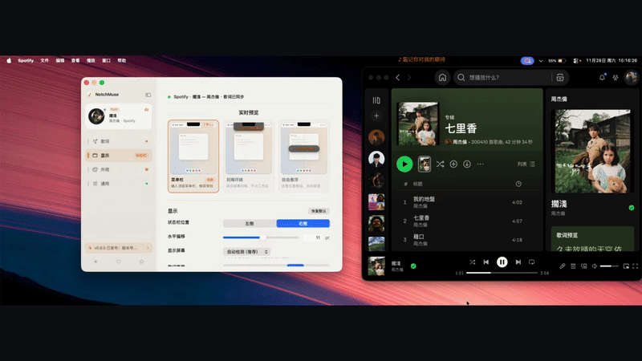
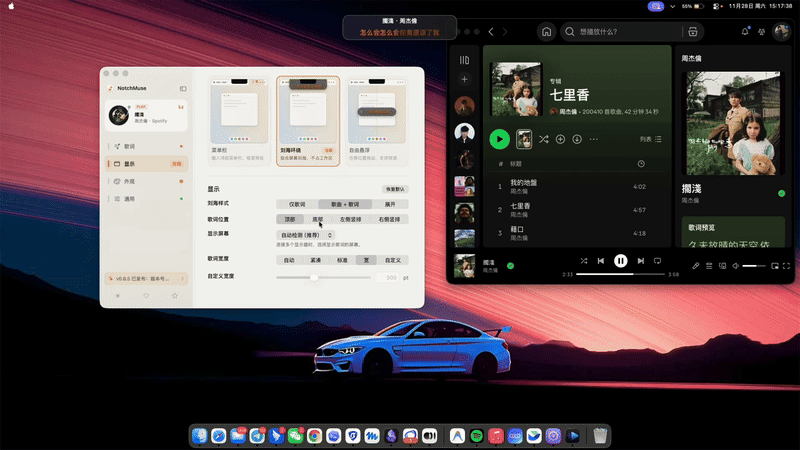
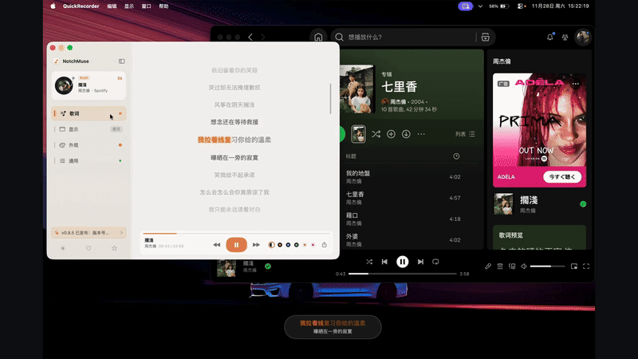
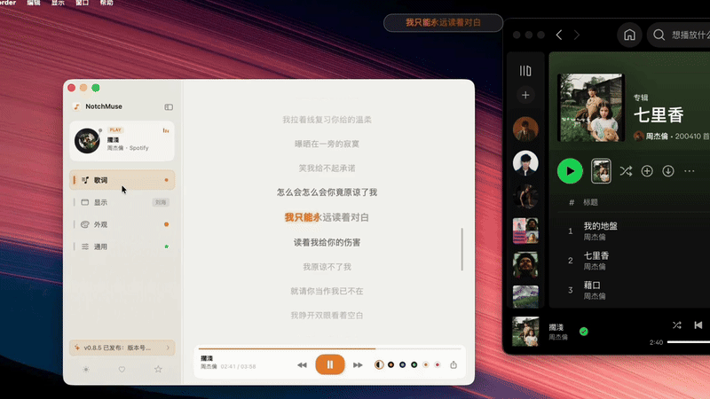
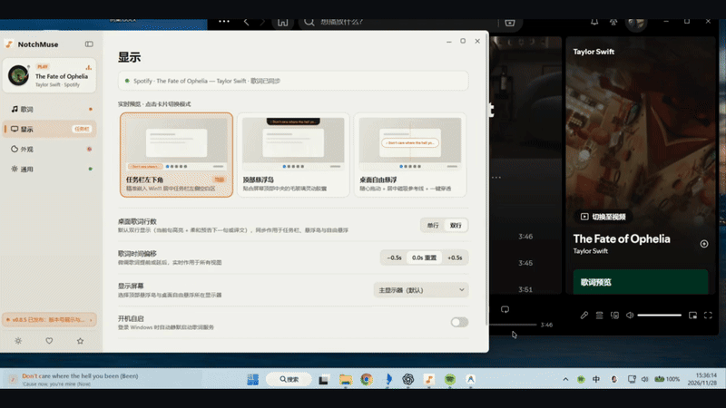
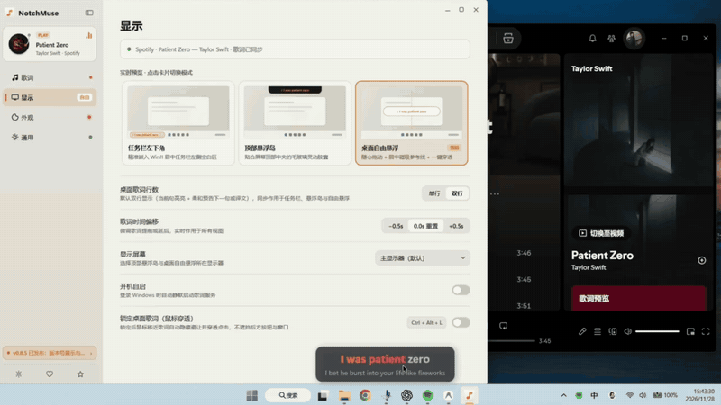
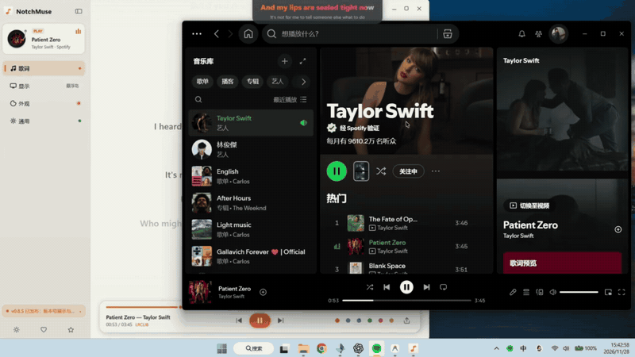

<h1 align="center"></h1>

<strong>Native · Lightweight · Free &amp; Open Source</strong>

Synced desktop lyrics for macOS 14+ (Apple Silicon) and Windows 11/10 (portable .exe). Works with 39+ music players, including Spotify, Apple Music, NetEase Cloud Music, and QQ Music.

  
  
  
  
  

  
  
  
  

<a href="README.zh-CN.md">简体中文</a> · <a href="#whats-new-v090">What's New</a> · <a href="#macos-showcase">macOS Showcase</a> · <a href="#windows-showcase">Windows Showcase</a> · <a href="#39-supported-players">39+ Players</a> · <a href="#quick-start">Quick Start</a> · <a href="#community--support">Community &amp; Support</a> · <a href="#contact">Contact</a>

## What's New · v0.9.0

- **One release for Mac and Windows.** Both platforms share Free Floating lyrics, Vinyl Studio, and the lyrics matching engine. Each also has its own desktop layouts.
- **Vinyl Studio.** The hi-fi player puts spinning album art next to immersive lyrics. Click a timed line to seek or turn it into a Lyrics Share Card.
- **More precise lyric matching.** The 7-platform × 800-song benchmark recorded **0 false positives across 280 instrumental tracks**.
- **39+ compatible players across both platforms.** Windows adds a bottom-left taskbar ticker, a top floating island, and an auto-flipping hover bar in Free Floating mode.

## macOS Showcase

| Menu Bar Lyrics | Notch Mode |
| --- | --- |
|  |  |

| Free Floating Lyrics + 6-Key Hover Bar | Vinyl Studio Immersive Lyrics & Single-Click Seek |
| --- | --- |
|  |  |

## Windows 11/10 Showcase

| Win11 Taskbar Bottom-Left Lyrics | Free Floating Lyrics + Auto-Flip 6-Key Hover Bar |
| --- | --- |
|  |  |

### Top Floating Island + Vinyl Studio Live Sync

## macOS & Windows Feature Comparison

| Feature | macOS 14+ | Windows 11/10 |
| --- | --- | --- |
| Download | Apple Silicon DMG | x64 portable .exe |
| System layouts | Menu Bar · MacBook Notch | Win11 Taskbar · Top Floating Island |
| Free Floating | Dual-line sweep, 6-key hover bar, 7-color palette, lock and click-through | Dual-line sweep, auto-flipping 6-key hover bar, 7-color palette, lock and click-through |
| Vinyl Studio | Spinning album vinyl, immersive lyrics, click-to-seek and Lyrics Share Card | Spinning album vinyl, immersive lyrics, click-to-seek and Lyrics Share Card |

## 39+ Supported Players

Play music in Spotify, Apple Music, YouTube Music, NetEase Cloud Music, QQ Music, Soda Music, TIDAL, Qobuz, Plexamp, Roon, or another compatible player. Windows follows players that expose a system media session, including MusicBee and foobar2000 when configured. Compatibility and playback controls vary by platform and player.

[See the player compatibility directory](https://notchmuse.com/compatible-players/).

## Quick Start

1. **Get NotchMuse.** On macOS 14+ with Apple Silicon, open the [DMG](https://github.com/Xiye88/NotchMuse/releases/latest/download/NotchMuse.dmg) and drag NotchMuse to Applications. On Windows 11/10 x64, run the [portable .exe](https://github.com/Xiye88/NotchMuse/releases/latest/download/NotchMuse-Windows-win-x64-portable.exe) directly.
2. **Play a song.** Open a supported player and start playback. On Mac, allow Automation if prompted so the app can follow the track. No NotchMuse account is required.
3. **Choose where lyrics appear.** Pick a system layout or Free Floating in Settings, or open Vinyl Studio to follow the whole song.

## Privacy & Security

NotchMuse works without an account, collects no app telemetry, and does not capture or upload audio. It reads playback metadata. Track title, artist, album, and duration may be sent to third-party lyrics providers to find a match. Lyric availability varies by track and provider.

On macOS, use **System Settings → Privacy & Security → Open Anyway** if the official download is blocked at first launch. See [installation and permissions help](docs/community/SUPPORT.md) and [Apple’s instructions](https://support.apple.com/en-us/102445).

NotchMuse is [MIT-licensed](LICENSE). See [Third-Party Notices](THIRD_PARTY_NOTICES.md) and the [developer documentation](docs/README.md).

## Community & Support

| WeChat Pay | QQ User Group (1137981671) | USDT · EVM |
| :---: | :---: | :---: |
|  |  |  |
| Support development | [Join on QQ](https://qm.qq.com/q/J6W0oSPtu0) | ETH · BSC · Arbitrum · Optimism USDT only |

## Feedback & Business Collaboration

- **Email** [support@notchmuse.com](mailto:support@notchmuse.com) for feedback and business collaboration.
- **Community** [Join QQ User Group 1137981671](https://qm.qq.com/q/J6W0oSPtu0) to talk with other listeners.
- **GitHub** [Open an issue](https://github.com/Xiye88/NotchMuse/issues) to report a bug or request a feature.

## Star History

<a href="https://www.star-history.com/#Xiye88/NotchMuse&amp;Date">
  <picture>
    <source media="(prefers-color-scheme: dark)" srcset="https://api.star-history.com/svg?repos=Xiye88/NotchMuse&amp;type=Date&amp;theme=dark">
    <source media="(prefers-color-scheme: light)" srcset="https://api.star-history.com/svg?repos=Xiye88/NotchMuse&amp;type=Date">
    
  </picture>
</a>
