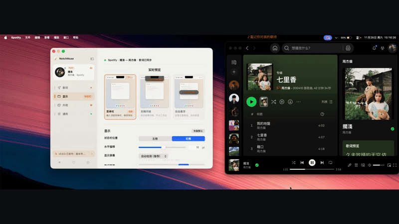
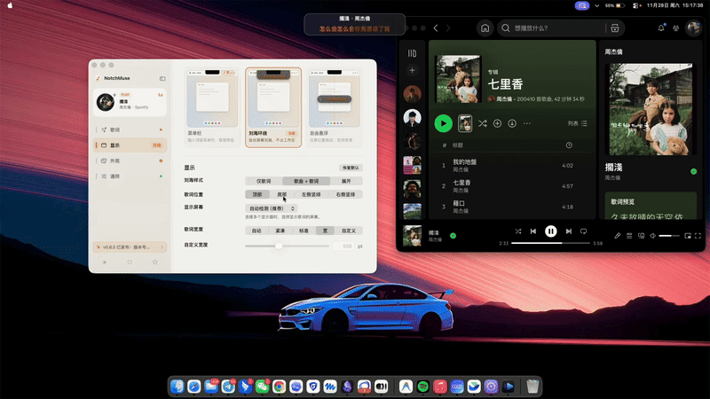
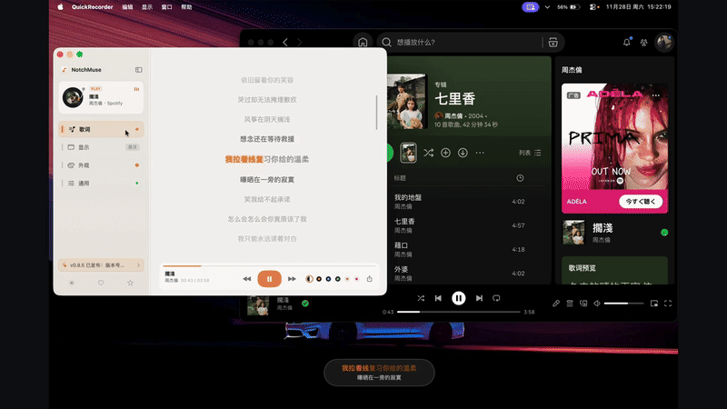
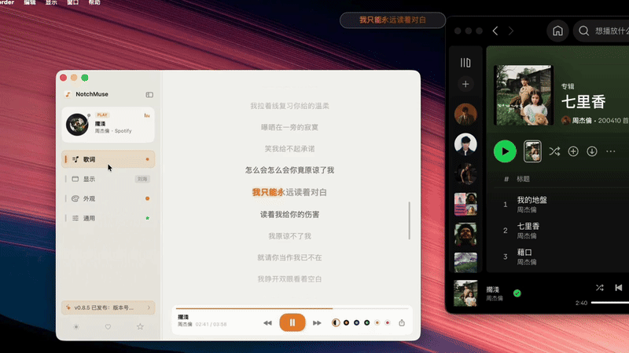
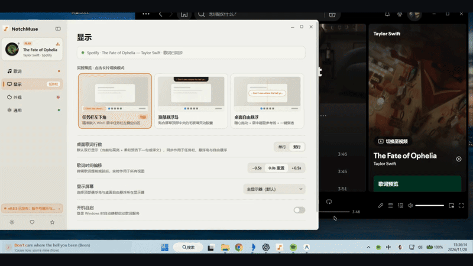
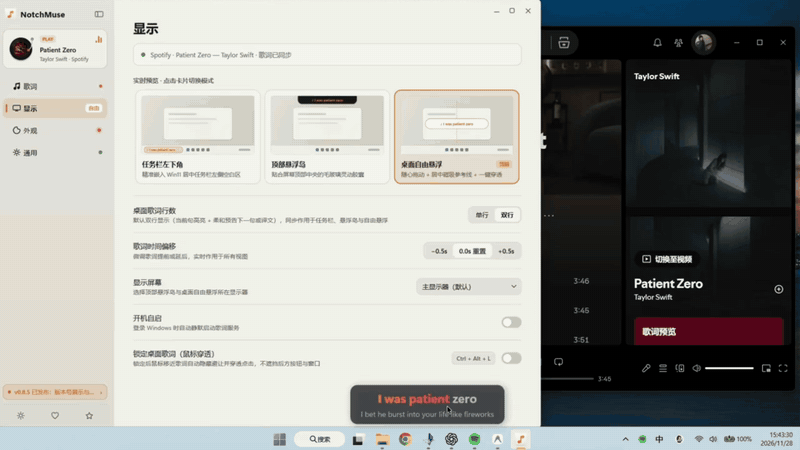
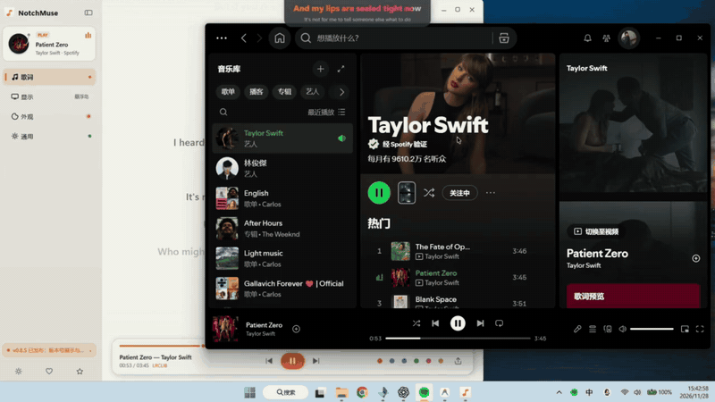

<h1 align="center"></h1>

<strong>原生 · 轻量 · 免费开源</strong>

适用于 macOS 14+（Apple 芯片）和 Windows 11/10（便携版 .exe）的同步桌面歌词。 兼容 39+ 款音乐播放器，从 Spotify、Apple Music 到网易云音乐和 QQ 音乐。

  
  
  
  
  

  
  
  
  

<a href="README.md">English</a> · <a href="#whats-new-v090">版本亮点</a> · <a href="#macos-showcase">macOS 演示</a> · <a href="#windows-showcase">Windows 演示</a> · <a href="#39-supported-players">39+ 款播放器</a> · <a href="#quick-start">快速上手</a> · <a href="#community--support">社区与支持</a> · <a href="#contact">联系方式</a>

## v0.9.0 版本亮点

- **Mac 与 Windows 双端发布。** 两端共用自由悬浮歌词、黑胶工作室与歌词匹配引擎，同时保留各自的桌面歌词布局。
- **黑胶工作室。** Hi-Fi 播放界面用旋转黑胶展示专辑封面。点击带时间戳的歌词即可跳转进度，也能生成歌词分享卡。
- **歌词匹配更准确。** 覆盖 7 个平台 × 800 首歌曲的测评中，**280 首纯音乐没有一首误配歌词**。
- **双端合计兼容 39+ 款播放器。** Windows 支持左下角任务栏歌词、顶部浮岛和带自动翻转工具条的自由悬浮歌词。

## macOS 实机演示

| 菜单栏歌词 | 刘海模式 |
| --- | --- |
|  |  |

| 自由悬浮歌词与六键工具条 | 黑胶工作室沉浸歌词与单点跳转 |
| --- | --- |
|  |  |

## Windows 11/10 实机演示

| Win11 左下角任务栏歌词 | 自由悬浮歌词与自动翻转六键工具条 |
| --- | --- |
|  |  |

### 顶部浮岛与黑胶工作室实时联动

## macOS 与 Windows 功能对比

| 功能 | macOS 14+ | Windows 11/10 |
| --- | --- | --- |
| 下载格式 | Apple 芯片版 DMG | x64 便携版 .exe |
| 系统栏布局 | 菜单栏 · MacBook 刘海 | Win11 任务栏 · 顶部浮岛 |
| 自由悬浮 | 双行滚动高亮、六键悬浮工具条、七色调色板、锁定与点击穿透 | 双行滚动高亮、自动翻转六键工具条、七色调色板、锁定与点击穿透 |
| 黑胶工作室 | 旋转专辑唱片、沉浸歌词、点击跳转、歌词分享卡 | 旋转专辑唱片、沉浸歌词、点击跳转、歌词分享卡 |

## 兼容 39+ 款播放器

支持 Spotify、Apple Music、YouTube Music、网易云音乐、QQ 音乐、汽水音乐、TIDAL、Qobuz、Plexamp、Roon 等。Windows 通过系统媒体会话同步，MusicBee 和 foobar2000 等播放器可能需要先启用相应集成。兼容情况和播放控制能力随平台和播放器而异。

[查看兼容播放器目录](https://notchmuse.com/zh/compatible-players/)。

## 快速上手

1. **下载 NotchMuse。** 使用 Apple 芯片的 macOS 14+ 用户打开 [DMG](https://github.com/Xiye88/NotchMuse/releases/latest/download/NotchMuse.dmg)，将应用拖入「应用程序」。Windows 11/10 x64 用户直接运行[便携版 .exe](https://github.com/Xiye88/NotchMuse/releases/latest/download/NotchMuse-Windows-win-x64-portable.exe)。
2. **播放一首歌。** 打开兼容的音乐播放器并开始播放。Mac 如有提示，允许自动化权限以同步曲目。两端都无需注册 NotchMuse 账号。
3. **选一个歌词位置。** 在设置中切换系统栏或自由悬浮，也可以打开黑胶工作室，从头到尾跟着歌词听。

## 隐私与安全

NotchMuse 无需注册，不收集应用遥测数据，也不录制或上传音频。应用读取播放信息，并可能将歌名、歌手、专辑和时长发给第三方歌词服务以匹配歌词。能否找到歌词取决于歌曲和服务覆盖情况。

若 macOS 首次打开官方版本时拦截了应用，可前往「系统设置 → 隐私与安全性 → 仍要打开」。详见[安装与权限说明](docs/community/SUPPORT.md)和 [Apple 指引](https://support.apple.com/zh-cn/102445)。

NotchMuse 采用 [MIT 许可证](LICENSE)。更多信息请见[第三方组件声明](THIRD_PARTY_NOTICES.md)和[开发文档](docs/README.md)。

## 社区与支持

| QQ 用户群（1137981671） | USDT · EVM |
| :---: | :---: |
|  |  |
| [点击加群](https://qm.qq.com/q/J6W0oSPtu0) | ETH · BSC · Arbitrum · Optimism 仅限 USDT |

## 反馈与商务合作

- **邮箱** [support@notchmuse.com](mailto:support@notchmuse.com)，欢迎反馈与商务合作。
- **交流** [加入 QQ 用户群 1137981671](https://qm.qq.com/q/J6W0oSPtu0)，和其他用户交流。
- **GitHub** [提交 Issue](https://github.com/Xiye88/NotchMuse/issues)，报告问题或提出功能建议。

## Star 趋势

<a href="https://www.star-history.com/#Xiye88/NotchMuse&amp;Date">
  <picture>
    <source media="(prefers-color-scheme: dark)" srcset="https://api.star-history.com/svg?repos=Xiye88/NotchMuse&amp;type=Date&amp;theme=dark">
    <source media="(prefers-color-scheme: light)" srcset="https://api.star-history.com/svg?repos=Xiye88/NotchMuse&amp;type=Date">
    
  </picture>
</a>
